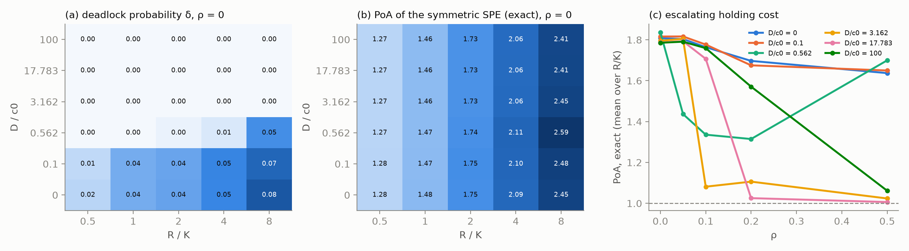
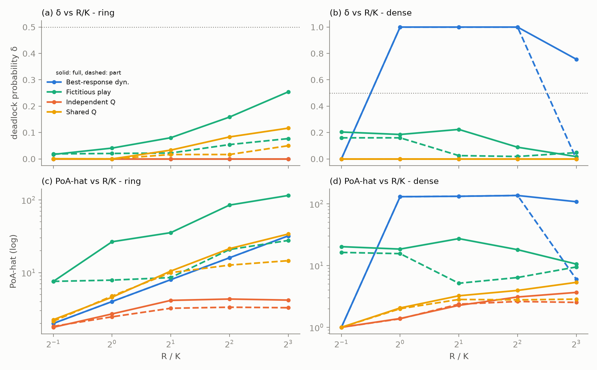
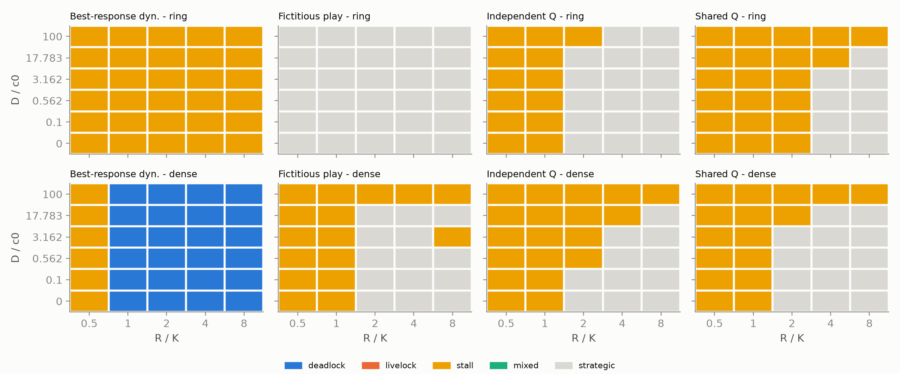
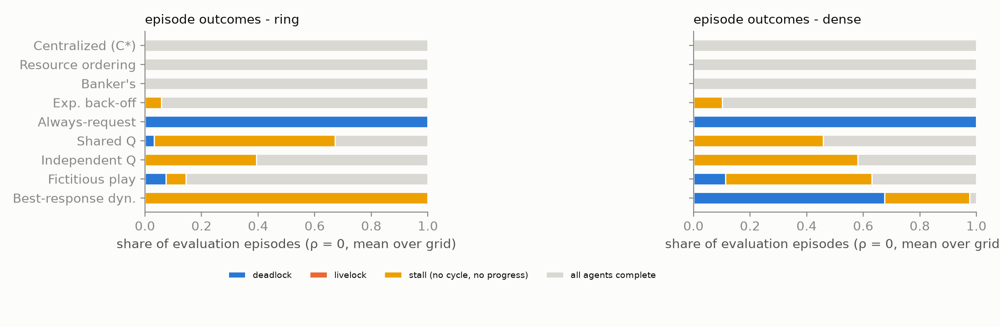
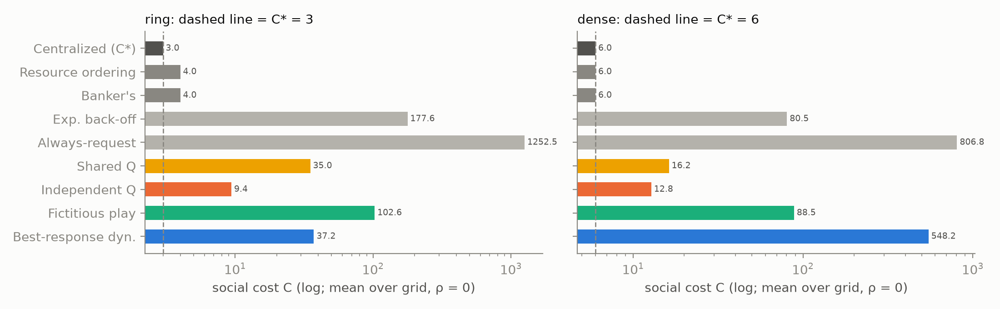
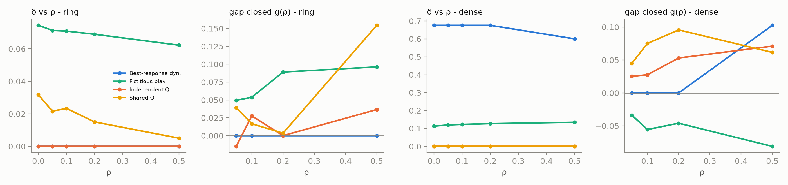

# Strategic Resource Contention and Deadlock in Multi-Agent Systems

Course project for CS329 (Multi-Agent Systems), IIT Gandhinagar.
Group 11: Nityanand Karmali, Patil Nachiket Kiran, Devashish, Devvrat Hans.

- Report: [report/main.pdf](report/main.pdf) (LaTeX source: [report/main.tex](report/main.tex))
- Proposal: [Group11_Project_Idea_Review.pdf](Group11_Project_Idea_Review.pdf)

## What the project is about

Deadlock is normally handled by something central, like a lock manager running the Banker's algorithm or a rule that
everyone grabs resources in the same global order. We wanted to see what happens when nobody is in charge.

In our model each agent needs a few locks in a fixed order. Every step it chooses Request, Hold or Yield on its own and
only cares about its own payoff. Finishing gives a reward R. Yielding costs K. Holding a lock costs something every
step. Being stuck in a circular wait costs D per step. We set this up as a finite-horizon stochastic game and asked
two questions:

1. **RQ1:** For which values of R/K, D, topology (ring or dense) and information (full or partial) do selfish agents
   end up deadlocked? Is there a threshold θ in R/K where this switches on?
2. **RQ2:** Suppose every agent charges itself a holding cost that grows the longer it holds, φ_ρ(h) = c0(1+ρ)^h.
   Does that help? We measure g(ρ), the fraction of the gap to the centralized optimum C* that it closes.

We compare these methods:

- exact two-agent equilibria (backward induction with nashpy)
- best-response dynamics
- fictitious play
- independent and shared Q-learning
- the classical baselines: always-request, Banker's algorithm, resource ordering, exponential back-off, and the centralized optimum

## Setup

You need Python 3.10 or newer.

```bash
make setup     # creates .venv and installs requirements.txt
make test      # 23 unit tests
make trace     # prints a small three-agent ring trace that you can check by hand
```

## Results

The numbers below are averages over the grid. Per-cell values with 95% confidence intervals are in
`results/all/summary.csv`. The full grid has 14,040 runs and took about 29 CPU-hours.

### Two agents, solved exactly

With two agents the whole game can be solved exactly.

- In every cell, Yield is already in the equilibrium at the first holding step (h* = 1). The agents back off early, so
  deadlock is rare: δ ≤ 0.08, and exactly 0 once D/c0 ≥ 3.16. This means there is no threshold θ for two agents.
- The equilibrium is still wasteful. C/C* goes from 1.27 at R/K = 0.5 up to 2.46 at R/K = 8.
- The escalating holding cost helps here. Mean C/C* drops from 1.81 at ρ = 0 to 1.35 at ρ = 0.5.
- As a sanity check, every computed equilibrium has exploitability below 1e-12.



We also ran all the other methods on this two-agent game (`make standoff`) to see whether they find the equilibrium.
They don't:

- Independent Q gets closest, with PoA-hat 3.6 against 1.8 for the exact equilibrium, but 41% of its episodes stall.
- Shared Q and best-response dynamics stall even more often.
- Fictitious play deadlocks more often than the equilibrium (δ = 0.11).

The holding cost closes 56% of the gap for the exact equilibrium, but almost none of it for the learners.

### Three agents (RQ1)

Only best-response dynamics on the dense topology really deadlocks:

- δ = 1 for R/K = 1, 2 and 4, which puts θ at about 0.75.
- This is the same for every D and for both information regimes.

The Q-learners avoid deadlock. Partial information lowers δ for every method that deadlocks at all.



The regime map below shows which outcome dominates each (R/K, D) cell. For the Q-learners, the boundary between
"stall" and normal play moves to higher R/K as D grows.



**Stalls.** We expected livelock, but it almost never happens. What we saw instead were episodes that end with some
agent unfinished, with no deadlock and no livelock. We call these stalls. Two causes:

- On the ring, best-response dynamics keeps switching between "everyone requests" and "nobody requests".
- The Q-learners often never request a lock at all. This happens more when R/K is low or D is high.

We added a `stall` metric for these episodes in `deadlock_game/metrics.py`.



We expected parameter sharing to make Q-learning more stable, but it went the other way. On the ring, the standard
deviation of C across seeds is 17.1 for shared Q and 1.0 for independent Q.

### Comparison with the baselines

Each method's cost as a multiple of C*:

| Method | Cost |
|---|---|
| Banker's algorithm, resource ordering | C* on dense, 1.33 × C* on the ring |
| Independent Q | 2–3 × C* |
| Exponential back-off | 13–59 × C* |
| Always-request | 134–417 × C* |



### Escalating holding cost with three agents (RQ2)

It helps a little:

- On average g(ρ) is at most 0.15.
- With independent Q at ρ = 0.5, the cost drops significantly in 15 of the 60 dense cells (paired t-test over 10 seeds).
- It never caused livelock.

It can't do more because of the stalls. An agent that never picks up a lock never pays the holding cost, so the
mechanism doesn't affect it.



There are more per-cell plots in `results/figures/` (regime maps for each method, topology and information regime).

## Reproducing the results

`experiments/make_report_assets.py` builds every table and figure in the report from the CSVs in `results/`. It also
writes the numbers we quote in the report text to `report/numbers.txt`, so they can be checked against the data.
None of this needs the experiments to be rerun:

```bash
make report    # tables, figures, numbers.txt, then the PDF (needs tectonic or pdflatex)
```

To rerun the experiments from scratch, use the commands below. All runs are seeded, so you get the same CSVs.

| Command | What it does | Time (8 cores) |
|---|---|---|
| `.venv/bin/python experiments/stage1_two_agent.py --out results/stage1` | exact two-agent equilibria | about 5 h |
| `.venv/bin/python experiments/run_grid.py --preset all --out results/all` | Stages 2–4 and baselines, full grid | about 6 h |
| `make outcomes` | ρ = 0 cells again, with the stall metric | about 1 h |
| `make standoff` | every method on the two-agent game | about 1 h |
| `make stage1-quick` / `make quick` | smaller grids for testing | a few minutes |

`run_grid.py` saves progress to `<out>.partial` and resumes from there if it gets interrupted. Any axis of the grid can
be restricted, for example:

```bash
.venv/bin/python experiments/run_grid.py --preset stage4 --topologies ring --rk 2 8 --D 0 10 --seeds 10
```

`make_report_assets.py` also checks that the `results/outcomes` rerun reproduces the social cost of the main run in
every cell. The largest difference is about 1e-13.

**Grid** (from the proposal):

| Setting | Values |
|---|---|
| R/K | 0.5, 1, 2, 4, 8 |
| D/c0 | 0, 0.1, 0.56, 3.16, 17.8, 100 |
| ρ | 0, 0.05, 0.1, 0.2, 0.5 |
| Information | full, partial |
| Topology | ring and dense (3 agents, 3 locks) |
| Seeds | 10 |
| Other defaults | K = 4, c0 = 1, H = 20, τ_max = 3, L = 4, γ = 0.95, h̄ = 4 |

**Outputs:**

- `results/stage1/stage1_two_agent.csv`: one row per (R/K, D, ρ) with
  - h* and P(Yield) at h = 1..5
  - δ, λ, C, C* and PoA-hat
  - the PoA band over equilibrium selections
  - ε of the computed equilibrium
  - the equilibria of the one-shot matrix M_ρ(1)
- `results/<run>/raw.csv`: one row per cell and seed.
- `results/<run>/summary.csv`: mean and 95% CI per cell, plus g(ρ).
- `results/<run>/thresholds.csv`: θ, the R/K at which δ crosses 1/2.
- `results/all_quick/`: an early small test run. The report does not use it.

## Code layout

| Proposal stage | Code | Owner |
|---|---|---|
| Game, topologies, grid | `deadlock_game/config.py` | Nityanand |
| Stage 0: simulator with `step(state, actions) -> (next_state, rewards, info)`, Wait-For Graph cycle detection (Tarjan SCC), seeded randomness | `deadlock_game/env.py`, `deadlock_game/wfg.py` | Nachiket |
| Centralized optimum C* (DP over the joint state space), Banker's algorithm | `deadlock_game/exact.py`, `deadlock_game/baselines.py` | Nachiket |
| Stage 1: stage games with continuation values, equilibria via nashpy, h*, θ | `deadlock_game/two_agent.py`, `experiments/stage1_two_agent.py` | Nityanand |
| Stage 2: best-response dynamics, back-off, resource ordering, grid runner | `deadlock_game/best_response.py`, `deadlock_game/baselines.py`, `deadlock_game/experiments.py`, `experiments/run_grid.py` | Devashish |
| Stage 3: independent Q, shared Q, fictitious play, convergence rule, exploitability | `deadlock_game/learning.py`, `deadlock_game/exact.py` | Devvrat |
| Stage 4: ρ sweep and g(ρ) | `experiments/run_grid.py --preset stage4`, `deadlock_game/experiments.py` | Devvrat |
| Metrics: δ, λ, stall, completion, latency, C, PoA-hat, g(ρ), 95% CIs | `deadlock_game/metrics.py` | Nityanand |
| Plots and report tables | `experiments/make_plots.py`, `experiments/make_report_assets.py` | Nityanand |
| Tests | `tests/` | everyone |

## Modelling choices

The proposal left a few details open. This is what we went with:

1. **State.** An agent always holds a prefix of its order o_i, so we only store how many locks it holds. The state is
   `(p, h, κ, d, cyc)`. `cyc[i]` records whether agent i was on a cycle in the previous step, which the
   full-information observation needs. With ρ = 0, h only matters up to h̄, so we cap it there. This keeps the exact
   solvers small without losing anything.
2. **Wait-For Graph.** There is an edge i → j when i requested this step, didn't get the lock, and its next lock is held
   by j. An agent that just got a lock has no pending request.
3. **Illegal actions** (Request or Yield while done or cooling down) are turned into Hold by the environment.
4. **Livelock and stall.** Livelock means no deadlock, some agent unfinished at the horizon, and at least one Yield in
   every window of L steps. Stall means some agent unfinished at the horizon, but neither deadlock nor livelock. We
   added stall after Stage 2.
5. **Social cost.** C = Σ_i (R − U_i^0), where U^0 is the undiscounted return under the base payoff (ρ = 0). The agents
   maximise their own discounted ρ-payoff, and exploitability is measured in that objective.
6. **Best responses** (`exact.best_response`) are exact backward induction over joint state and time.
   - The deviating agent sees the full state, so the ε we report is an upper bound on exploitability among
     observation-based policies.
   - For best-response dynamics and fictitious play, we convert the full-state best response into an observation
     policy using occupancy-weighted Q-values (`exact.project_to_observations`).
7. **Stage 1** solves the whole two-agent game by backward induction.
   - At every (t, s) we solve the bimatrix stage game with continuation values. At the standoff states this is M_ρ(h)
     from Eq. (11) of the proposal.
   - We find the equilibria with nashpy's support enumeration. A separate check for pure equilibria handles degenerate
     games, where support enumeration can miss some.
   - One equilibrium is picked per stage: `symmetric` by default, or `welfare_max` / `welfare_min`, which give the PoA
     band.
8. **Dense topology.** The orders are drawn from a seed and redrawn until a circular wait is actually possible.
9. **Defaults.** K = 4, c0 = 1, R = (R/K)·K, H = 20, τ_max = 3, L = 4, γ = 0.95, h̄ = 4 (see `GameParams`).
10. **Fictitious play** averages the observation-policy tables entry by entry with step 1/(k+1). This is a common
    simplification of averaging behaviour strategies.

## Using the package directly

```python
from deadlock_game import DeadlockEnv, GameParams, ring
from deadlock_game.learning import train
from deadlock_game.metrics import evaluate_mc
from deadlock_game.exact import centralized_optimum

env = DeadlockEnv(ring(3), GameParams(R=16, K=4, D=10, rho=0.2))
res = train("sql", env, regime="part", seed=0)        # parameter-shared Q-learning
s = evaluate_mc(env, res.profile, episodes=1000)
c_star = centralized_optimum(env).c_star
print(s.deadlock, s.livelock, s.social_cost / c_star, res.epsilon)
```

## Contribution

| Member | Owned (code) | Reviewed | Status |
|---|---|---|---|
| Nityanand Karmali (24110226) | Formulation; Stage 1 (`two_agent.py`, `stage1_two_agent.py`); metrics, PoA, g(ρ) (`metrics.py`); plots, report | Stage 3 | Completed |
| Patil Nachiket Kiran (24110250) | Stage 0 simulator (`env.py`, `wfg.py`); C* and Banker's (`exact.py`, `baselines.py`); tests | Stage 1 | Completed |
| Devashish (24110104) | Stage 2 BR dynamics (`best_response.py`); back-off, resource ordering; grid runner (`experiments.py`, `run_grid.py`) | Stage 0 | Completed |
| Devvrat Hans (23110094) | Stage 3 learners and exploitability (`learning.py`, `exact.py`); Stage 4 ρ sweep | Stage 2 | Completed |
